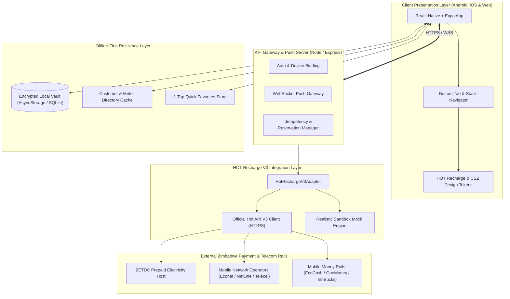
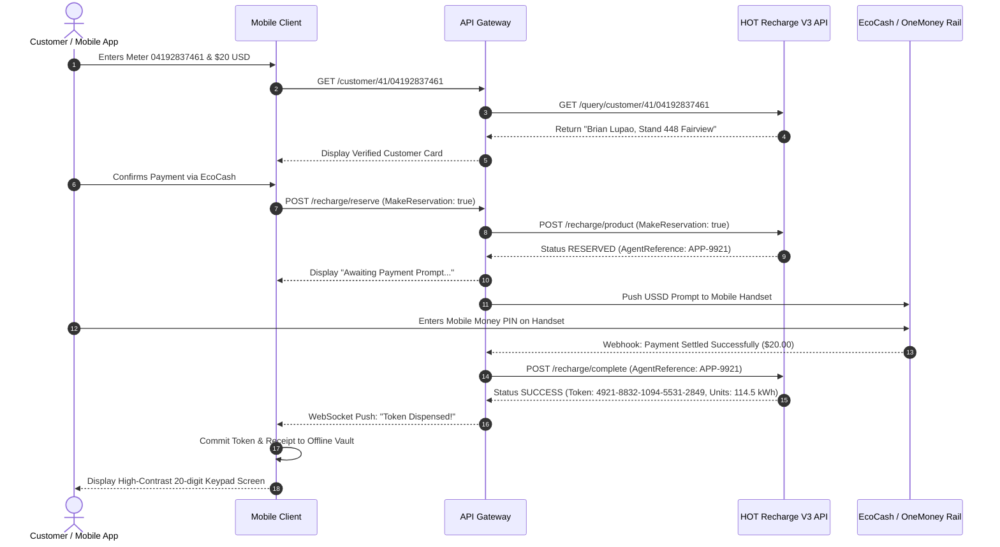

# System Architecture & Technical Design

**Project:** HOT Recharge Next-Gen Mobile Application  
**Competition:** Computer Society of Zimbabwe (CSZ) Hackathon 2026  
**Architect:** Brian Lupao  

---

## 1. High-Level System Architecture

---

## 2. Two-Stage "Reserved Recharge" Flow

The HOT Recharge V3 API natively supports two-stage transactions to safeguard against delayed mobile money USSD callbacks:

---

## 3. Security, Offline Resilience & Idempotency

### 3.1 Idempotency & Agent References
Each transaction generates an enterprise agent reference conforming to the official HOT Recharge V3 specification:
$$\text{Reference Format: } \text{HR-CBD01-APP-}[\text{Timestamp}]-[\text{UUID}]$$
This reference is tracked across the reservation, payment verification, and completion phases, preventing double charges in the event of packet loss or cellular reconnection.

### 3.2 Offline Token Storage
* Local storage uses persistent key-value mapping indexed by transaction reference and target meter number.
* Upon receiving a token response, the mobile client executes an asynchronous atomic write to local storage before presenting the token dialog.
* Users can open the **Offline Vault** at any time—even while airplane mode is active or when cellular towers are down during blackouts.

---

## 4. Design System Tokens & Typography

* **Primary Colors:** Flame Red (`#E51937`), Tagline Gold (`#F5A623`), CSZ Deep Navy (`#0A2540`).
* **Dark Background:** OLED Midnight (`#0D0F12`).
* **Surfaces:** Elevated Slate (`#1A1D24`, `#242832`).
* **Typography:** Clean sans-serif for UI navigation; Monospace 20px with 1.5 character spacing for the 20-digit token numbers.
